<!--
  Profile README for nefsi-abdelouahab.
  • ./assets holds the custom animated SVGs (CSS animations only, system fonts, no scripts).
  • The contribution snake is generated by .github/workflows/snake.yml into the "output" branch.
  • Search this file for "TODO" to find the project links still to fill in.
-->

<picture>
  <source media="(prefers-color-scheme: dark)" srcset="https://capsule-render.vercel.app/api?type=waving&color=0:151030%2C50:3A2A80%2C85:915EFF%2C100:56CCF2&height=200&section=header&text=Nefsi%20Abdelouahab&fontSize=46&fontColor=F3F3F3&fontAlignY=36&desc=AI%20Engineering%20Student%20%C2%B7%20Full-Stack%20Developer&descSize=16&descAlignY=56&animation=fadeIn">
  <source media="(prefers-color-scheme: light)" srcset="https://capsule-render.vercel.app/api?type=waving&color=0:56CCF2%2C100:915EFF&height=200&section=header&text=Nefsi%20Abdelouahab&fontSize=46&fontColor=151030&fontAlignY=36&desc=AI%20Engineering%20Student%20%C2%B7%20Full-Stack%20Developer&descSize=16&descAlignY=56&animation=fadeIn">
  
</picture>

  <picture>
    <source media="(prefers-color-scheme: dark)" srcset="https://readme-typing-svg.demolab.com?font=JetBrains+Mono&weight=600&size=22&duration=3000&pause=1200&color=56CCF2&center=true&vCenter=true&width=560&height=44&lines=AI+Engineering+Student;Full-Stack+Developer;Web+%26+Mobile+Developer;LLM+%26+AI+Agents+Explorer">
    <source media="(prefers-color-scheme: light)" srcset="https://readme-typing-svg.demolab.com?font=JetBrains+Mono&weight=600&size=22&duration=3000&pause=1200&color=6D3FE0&center=true&vCenter=true&width=560&height=44&lines=AI+Engineering+Student;Full-Stack+Developer;Web+%26+Mobile+Developer;LLM+%26+AI+Agents+Explorer">
    
  </picture>

  
  
  
  

  I'm a second-year Artificial Intelligence engineering student at <b>ESI-SBA (Higher School of Computer Science), Algeria</b>,
  with a strong foundation in software engineering and a passion for building practical digital solutions.


<h2 align="center">About me</h2>

  

  I work across <b>Web &amp; Mobile Development</b>, building modern applications and integrating backend services, APIs,
  and database-driven workflows. Alongside software engineering, I'm expanding my knowledge in
  <b>Machine Learning, Natural Language Processing, Large Language Models, and AI Agents</b>.

  I'm passionate about combining software engineering and artificial intelligence to build useful, scalable,
  and intelligent applications.

<b>About me as plain text</b>

 

- 🎓 Second-year Artificial Intelligence Engineering Student at ESI-SBA.
- 💻 Full-Stack Developer with experience in Web and Mobile application development.
- 🤖 Exploring Machine Learning, NLP, LLMs, and AI Agent development.
- 🧠 Learning to build AI-powered applications using LangChain and modern AI tools.
- 👥 Experienced in collaborative development within Agile Scrum teams.
- 🔍 Interested in AI research, practical experimentation, and continuous learning.
- 📊 Exploring Data Science through hands-on projects and Kaggle competitions.
- 📍 Timimoun, Algeria.

<h2 align="center">Tech stack</h2>

  
  
   
  
  
   
  
  

Tech icons from <a href="https://skillicons.dev">skillicons.dev</a> and <a href="https://simpleicons.org">Simple Icons</a>.

<h2 align="center">Featured projects</h2>

  <!-- TODO(presencia): replace this href with the Presencia repository or live demo URL. -->
  <a href="https://github.com/nefsi-abdelouahab"></a>
  <!-- TODO(khdamli): replace this href with the Khdamli repository or live demo URL. -->
  <a href="https://github.com/nefsi-abdelouahab"></a>
   
  <!-- TODO(roeya): replace this href with the Roeya repository or live demo URL. -->
  <a href="https://github.com/nefsi-abdelouahab"></a>
  

<i>Logistics Management System: additional project details are confidential.</i>

<h2 align="center">Current focus</h2>

  

<h2 align="center">GitHub activity</h2>

<!-- These two cards are generated daily by .github/workflows/snake.yml (GitHub Readme Stats action). -->

  
  

  

  

  <picture>
    <source media="(prefers-color-scheme: dark)" srcset="https://raw.githubusercontent.com/nefsi-abdelouahab/nefsi-abdelouahab/output/github-snake-dark.svg">
    <source media="(prefers-color-scheme: light)" srcset="https://raw.githubusercontent.com/nefsi-abdelouahab/nefsi-abdelouahab/output/github-snake.svg">
    
  </picture>

<h2 align="center">Let's connect</h2>

  
  
  
  

  <i>"Building software, exploring intelligence, and turning ideas into reality."</i>

  ⭐ Feel free to explore my repositories and connect with me!

<picture>
  <source media="(prefers-color-scheme: dark)" srcset="https://capsule-render.vercel.app/api?type=waving&color=0:151030%2C50:3A2A80%2C85:915EFF%2C100:56CCF2&height=120&section=footer">
  <source media="(prefers-color-scheme: light)" srcset="https://capsule-render.vercel.app/api?type=waving&color=0:56CCF2%2C100:915EFF&height=120&section=footer">
  
</picture>
